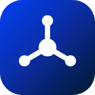

<p align="center"></p>

# Project Forge

**نظام تشغيل لفريق وكلاء الذكاء الاصطناعي.** أمر واحد يحوّل مجلدًا عاديًا إلى مكتب عمل منضبط: لوحة واحدة يعمل منها كل الوكلاء على أي منصة، وبوابة جودة مستقلة، وحوكمة قرارات، وأثر تدقيق، ومؤشرات أداء تُصدَّر إلى Power BI، وموقع إدارة يعمل من ملف HTML واحد.

بايثون 3.9 فما فوق، بلا أي مكتبة خارجية، وبلا خادم. [English below](#english).

## التثبيت

سطر واحد يُلصق في الطرفية: يحمّل الأداة ويشغّلها ويسأل أربعة أسئلة ثم يفتح موقع الإدارة.

macOS وLinux:

```
curl -fsSL https://raw.githubusercontent.com/hakami-bros/project-forge/main/install.sh | bash
```

Windows (PowerShell):

```
irm https://raw.githubusercontent.com/hakami-bros/project-forge/main/install.ps1 | iex
```

أو نزّل `Project Forge.zip` من صفحة الإصدارات وانقر مرتين على `Project Forge.command` (Mac) أو `Project Forge.bat` (Windows). تفتح الأداة صفحة بسيطة في المتصفح: تكتب اسم مشروعك وهدفه، وتختار فريقك وتعدّل أدواره بالنقر، ثم تضغط «أنشئ المشروع». لا حاجة إلى Terminal بعد التثبيت. المشاريع تُنشأ في `Documents/Project Forge`.

## ما الذي يحله

المحادثات مع الذكاء الاصطناعي تنسى، وتتعارض، ولا تُقاس. هنا المجلد هو الذاكرة، واللوحة هي العقل المشترك، والأرقام هي الحكم:

| المشكلة | الحل |
| --- | --- |
| كل محادثة تبدأ من الصفر | `CLAUDE.md` وملف دور لكل وكيل يُقرأ من المجلد، لا من ذاكرة المحادثة |
| وكيلان يعملان على الشيء نفسه | لوحة واحدة بصفوف مرقمة، و«قيد التنفيذ» تحجز الصف، وبصمة تمنع الكتابة المتعارضة |
| مخرجات تصل إليك بلا فحص | رئيس ضمان الجودة يحكم «يمر أو لا يمر» قبل أن يصل أي مخرج إلى صاحب المشروع |
| قرارات معلقة تعطّل الفريق | سقف خمسة قرارات، ومهلة 48 ساعة تؤخذ بعدها التوصية، وسجل موسوم |
| لا أحد يعرف ما أُنجز | `report` يعطي نسبة التسليم وزمن الدورة ومرور الجودة والحمل، و`export` يصدّرها إلى Power BI |
| من غيّر ماذا؟ | `Agents/Audit Log.md` يسجّل كل كتابة، و`Data/Status History.csv` كل تغيّر حالة |
| بيانات حساسة في أدوات خارجية | `Docs/Data Policy.md` ملزم: تصنيف البيانات والأدوات المعتمدة |

## قوالب الفرق

ثلاثة وأربعون تخصصًا جاهزًا في سبع مجموعات، لكل منها فريق من خمسة أدوار تقريبًا وأمثلة أهداف، ومعها «مكتبة أدوار» من نحو 190 دورًا تضيف منها بنقرة:

| المجموعة | التخصصات |
| --- | --- |
| أعمال وإدارة | عام، شركة ناشئة، استشارات، مكتب إدارة مشاريع، مالية ومحاسبة، موارد بشرية، قانوني وامتثال، مشتريات ومنافسات، مشروع صغير، جودة وتميز مؤسسي، تدقيق داخلي |
| تسويق ومبيعات | تسويق وحملات، مبيعات، تجارة إلكترونية، دعم العملاء، علاقات عامة واتصال |
| تقنية وبيانات | برمجي، تحول بالذكاء الاصطناعي، عمليات وأداء، بيانات وذكاء أعمال، تطبيق جوال، حوكمة الأمن السيبراني، تطوير ألعاب |
| محتوى وإبداع | محتوى، تصميم وإبداع، إنتاج إعلامي، فعاليات ومؤتمرات، تأليف كتاب، ترجمة وتعريب |
| قطاعات | مطاعم وضيافة، عقارات، خدمات صحية إدارية، تعليم وتدريب، خدمات حكومية وسياسات، جمعيات ومبادرات، سلاسل إمداد، مقاولات وإنشاءات، سياحة وسفر |
| بحث وتطوير شخصي | بحث أكاديمي، مسار مهني وبحث عن عمل، حياتي وإنتاجيتي، ابتكار وبحث وتطوير |
| مخصص | فريق من الصفر |

مفاتيح القوالب للأمر `--preset`: general، software، transformation، operations، data، content، startup، consulting، pmo، finance، hr، legal، marketing، sales، ecommerce، support، hospitality، realestate، healthcare، education، government، nonprofit، supply، research، design، media، events، job، personal، mobile، cyber، construction، tourism، procurement، book، smallbiz، pr، excellence، innovation، audit، translation، games، blank.

وفي كل فريق «البوصلة»: مدير المكتب الذي تكلّمه وحده فيوزع العمل. وعند الإنشاء تعرض الأداة الفريق المقترح وتتيح لك حذف أي دور (`-2`) أو إضافة دور (`+الاسم | المجال`)، ودور ضمان الجودة ثابت. وتضيف أي دور لاحقًا بأمر `add-role`.

## المهارات ومكتبة الأوامر

مع كل مشروع 22 مهارة جاهزة تختار منها (قياس قبل وبعد، تقرير تنفيذي، مراجعة جودة، تحليل السبب الجذري، رسم إجراء، تصميم وكيل لإجراء، تحليل بيانات، لوحة مؤشرات، خطة مشروع، تحليل مخاطر وغيرها). المهارة ملف قصير في `Agents/Skills/` يحدد متى تُستعمل وخطواتها ومخرجها ومعيار قبولها، فيلتزم بها الموظف بدل الاجتهاد كل مرة. تضيف مهارة لاحقًا بأمر `add-skill` وتعرضها بأمر `skills`.

و`Agents/Commands Library.md` مكتبة أوامر جاهزة للنسخ: بدء المحادثات، وأوامر صاحب المشروع اليومية للبوصلة، وأوامر الجودة، والإغلاق والاستئناف، وأوامر الأداة. وتظهر نفسها في شاشة النجاح بعد الإنشاء مع زر نسخ لكل أمر.

## الأوامر

| الأمر | الوظيفة |
| --- | --- |
| `new` | ينشئ مشروعًا كاملًا |
| `build` | يعيد بناء موقع الإدارة من اللوحة |
| `watch` | يعيد البناء تلقائيًا عند تغيّر اللوحة |
| `rows` | يعرض الصفوف الجاهزة لدور |
| `add-row` | يضيف صفًا بأمان: رقم تلقائي ومنع للتعارض وسقف للمفتوح |
| `set-status` | يغيّر حالة صف؛ «معتمدة» و«ملغاة» بأمر صاحب المشروع فقط |
| `add-role` | يضيف دورًا ويحدّث القواعد والأوامر والموقع |
| `skills` | يعرض المهارات الجاهزة وما أُضيف منها |
| `add-skill` | يضيف مهارة جاهزة أو أكثر: `add-skill measure,deck` |
| `shortcut` | أيقونة على سطح المكتب تفتح الواجهة بنقرتين |
| `decide` | يسجّل قرارًا موسومًا في سجل القرارات |
| `report` | تقرير أداء: التسليم وزمن الدورة ومرور الجودة والحمل والقرارات المتأخرة |
| `export` | يصدّر اللوحة والفريق والقرارات والمؤشرات إلى CSV لـ Power BI وExcel |
| `check` | يفحص المشروع: التسمية والترقيم وسلامة اللوحة ومهلة القرارات |
| `register` | يسجّل المشروع في سجل مركزي للمشاريع |
| `selftest` | يختبر الأداة على مشروع مؤقت |

## للمطورين

```
git clone https://github.com/hakami-bros/project-forge.git
cd project-forge
python3 -m forge
python3 -I tests/testforge.py
python3 -I tools/build-single.py
```

```
forge/                حزمة الأداة (core.py) وقالب موقع الإدارة
tools/build-single.py يبني ملف الأداة الواحد المكتفي بنفسه في dist/
tools/build-site.py   يبني الموقع التعريفي site/index.html
tests/                اختبارات الوحدة واختبار المتصفح (Playwright)
site/                 الموقع التعريفي ومكتبة الأوامر وصورة المعاينة
launchers/            مشغّلات بنقرتين لـ Mac وWindows
```

الموقع يُنشر تلقائيًا على GitHub Pages عند الدفع إلى `main` (فعّل Pages من Settings ثم Source: GitHub Actions)، ووسم `v1.0.0` يرفع ملف الأداة الواحد و`Project Forge.zip` إلى صفحة الإصدارات.

## الترخيص

MIT.

---

## English

**Project Forge is an operating system for a team of AI agents.** One command turns a plain folder into a disciplined office: a single board every agent works from (on any platform), an independent QA gate, decision governance, a full audit trail, performance metrics exported to Power BI, and a management site that runs from a single HTML file.

Python 3.9+, no dependencies, no server. Arabic-first: every generated file, role brief and report is written in Arabic.

**Install** (macOS/Linux):

```
curl -fsSL https://raw.githubusercontent.com/hakami-bros/project-forge/main/install.sh | bash
```

Windows (PowerShell):

```
irm https://raw.githubusercontent.com/hakami-bros/project-forge/main/install.ps1 | iex
```

**What it solves**

- Chats forget: rules and role briefs live in the folder, not in chat memory.
- Agents collide: one numbered board, "in progress" locks a row, a checksum guard prevents conflicting writes.
- Unchecked output: a QA lead rules pass/fail before anything reaches the owner.
- Stalled decisions: a cap of five open decisions and a 48-hour rule after which the recommendation stands.
- Nothing is measured: `report` gives delivery rate, cycle time, QA pass rate and load per role; `export` writes CSVs for Power BI.
- No accountability: every board write is logged with who, when and what.
- Sensitive data in external tools: a binding data policy with classification and approved tools.

**Team presets:** general, transformation (AI transformation team), operations, data (BI), software, content. Add any role with `add-role`.

**Commands:** `new`, `build`, `watch`, `rows`, `add-row`, `set-status`, `add-role`, `decide`, `report`, `export`, `check`, `register`, `selftest`.

MIT licensed.
